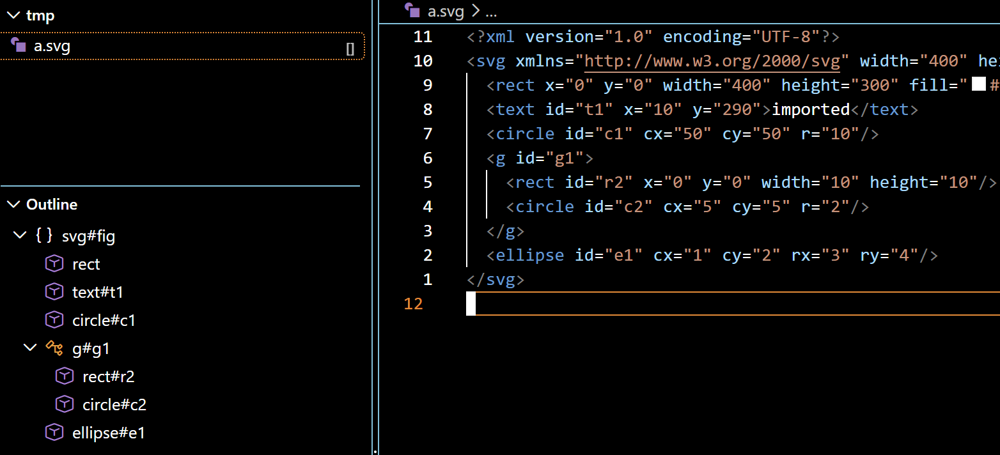
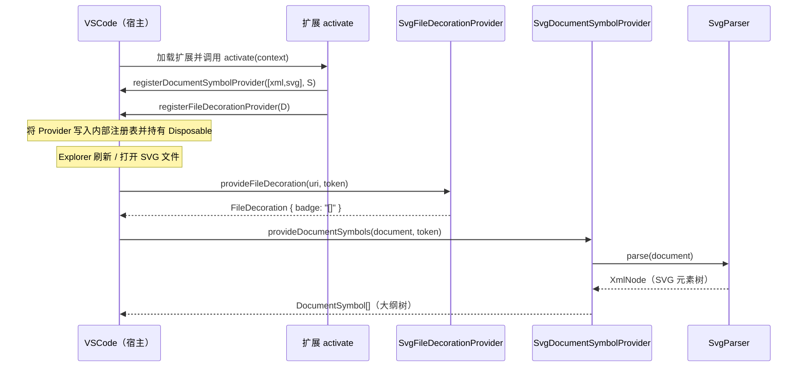

# demo README

<p align="center">
  <strong>VS Code Support for SVG Files</strong>
</p>

<p align="center">
  
</p>

This is the README for your extension "demo". Upon completion, it will be renamed
to `svg-vscode`.

# Try It

<ol>
  <li>Install node&gt;=24</li>
  <li>Open in VS Code</li>
  <li>Press Ctrl+F5 to run without debugging</li>
</ol>

Sample SVG used:
```xml
<?xml version="1.0" encoding="UTF-8"?>
<svg xmlns="http://www.w3.org/2000/svg" width="400" height="300" viewBox="0 0 400 300">
  <rect x="0" y="0" width="400" height="300" fill="#ffffff"/>
  <text id="t1" x="10" y="290">imported</text>
  <circle id="c1" cx="50" cy="50" r="10"/>
  <g id="g1">
    <rect id="r2" x="0" y="0" width="10" height="10"/>
    <circle id="c2" cx="5" cy="5" r="2"/>
  </g>
  <ellipse id="e1" cx="1" cy="2" rx="3" ry="4"/>
</svg>
```



# Features

| Description | Implemented By | Test |
|-------------|----------------|------|
| Tag SVG file with `[]` | `SvgFileDecorationProvider` | suite `svg file decoration` |
| Show SVG File Outline | `SvgDocumentSymbolProvider` | suite `SvgParser` |

# A.3 分析与提交

## 1. VSCode 与插件的职责及注册/调用过程

### 职责划分

| 角色 | 职责 |
|------|------|
| VSCode（宿主） | 读取 `package.json` 并按需激活扩展；维护各类 Provider 注册表；管理 Explorer、Outline 等界面视图；在需要数据时调用已注册的 Provider；负责渲染返回的装饰和大纲，并在卸载时释放 `Disposable`。 |
| 插件（本扩展） | 导出 `activate`/`deactivate` 生命周期入口；在 `activate` 中创建并注册 Provider；解析 SVG 生成元素树；决定哪些文件显示 `[]`；把计算结果返回给 VSCode，不直接操作界面。 |

VSCode 与插件通过**接口**解耦：插件只实现 `FileDecorationProvider`、`DocumentSymbolProvider` 等接口并注册，VSCode 只依赖接口调用，不关心具体实现。

### 注册与调用流程

1. VSCode 加载扩展，调用 `activate(context)`。
2. `activate` 创建 `SvgDocumentSymbolProvider` 与 `SvgFileDecorationProvider`，分别通过 `vscode.languages.registerDocumentSymbolProvider` 和 `vscode.window.registerFileDecorationProvider` 注册，并把返回的 `Disposable` 加入 `context.subscriptions`。
3. VSCode 把 Provider 存入内部注册表，建立“注册者 → 被调用者”的关系。
4. Explorer 刷新时，VSCode 对文件节点调用 `provideFileDecoration(uri, token)`；打开 SVG 时，Outline 调用 `provideDocumentSymbols(document, token)`。
5. Provider 计算并返回 `FileDecoration` / `DocumentSymbol[]`，由 VSCode 渲染到界面。



## 2. 文件装饰与 Decorator / Adapter 模式

### 涉及的接口、对象组合与调用关系

- **接口**：`SvgFileDecorationProvider implements vscode.FileDecorationProvider`，实现 `provideFileDecoration(uri, token)`；`SvgDocumentSymbolProvider implements vscode.DocumentSymbolProvider`，实现 `provideDocumentSymbols(document, token)`。返回值 `FileDecoration`、`DocumentSymbol` 都是携带展示信息的值对象。
- **对象组合**：VSCode 的注册表持有 Provider（组合关系）；Provider 返回的 `FileDecoration` 与文件树节点在渲染阶段由 VSCode 组合展示。装饰信息与文件对象是**分离的两个对象**，而不是包装关系。
- **调用关系**：采用“宿主拉取”模型——VSCode 在需要时主动调用 Provider，Provider 作为被查询的策略对象返回数据，并不持有或转发对文件对象的调用。

### 与经典 Decorator 模式的对应与差异

| 维度 | 经典 Decorator | 文件装饰 |
|------|----------------|----------|
| 意图 | 动态给对象增加职责 | 给 `.svg` 文件树节点增加 `[]` 标记 |
| 接口一致性 | 装饰者与组件实现同一接口，客户端无感知 | Provider 与文件对象接口不同，不存在透明替换 |
| 组合方式 | 装饰者“持有并包装”组件，形成委托链 | 宿主独立查询 Provider，再把返回值与节点组合展示 |
| 状态 | 装饰行为附着在包装对象上持续存在 | 装饰是每次查询时计算出的值对象，不修改文件名与内容 |
| 调用方向 | 客户端调装饰者，装饰者转发给组件 | 宿主调 Provider，Provider 返回元数据 |

结论：文件装饰在“**不修改原对象而增加展示信息**”的意图上与 Decorator 相似，但缺少“同接口包装 + 委托链 + 透明替换”这三个核心要素，因此更准确地说是一种**装饰元数据的 Provider/策略**，而非严格的 Decorator。

### 与经典 Adapter 模式的对应与差异

- **对应**：`SvgFileDecorationProvider` 把内部判定逻辑（`hasSvgExtension` + `workspace.fs.stat`）适配成 VSCode 期望的 `FileDecorationProvider` 接口；`SvgDocumentSymbolProvider` 把 `SvgParser`/`XmlNode` 适配成 `DocumentSymbol[]`。这体现了 Adapter“转换接口以适配目标调用方”的一面。
- **差异**：
  - 经典 Adapter 包装一个已有的 Adaptee 对象并逐方法转译；这里的装饰 Provider 直接调用工具函数，不存在可被逐方法转译的稳定 Adaptee 对象；`SvgDocumentSymbolProvider` 每次新建 `SvgParser`，更像是“使用/编排”而非“包装转译”。
  - Adapter 通常是点对点的接口转换；VSCode 的 Provider 注册表允许多个 Provider 共存并由宿主合并，属于插件/策略架构。
  - 返回值是数据对象（`FileDecoration` / `DocumentSymbol[]`），而不是把调用转发给另一个对象。

结论：Provider 在“**把内部实现转换成宿主所需接口**”这一点上承担了 Adapter 的角色，但整体上更准确的定位是**面向接口的插件扩展点**。
